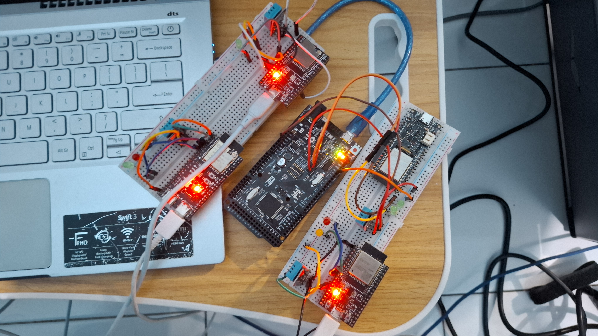
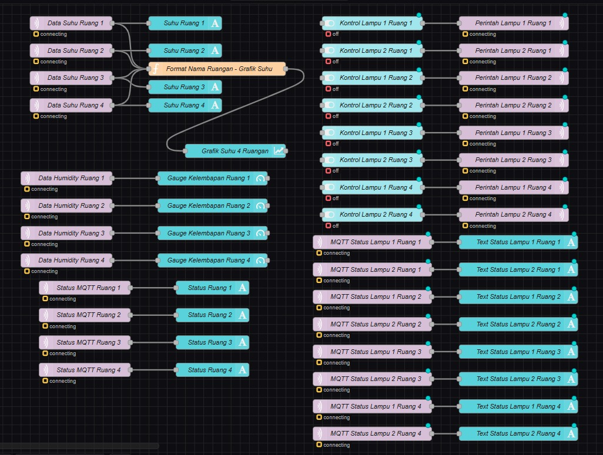
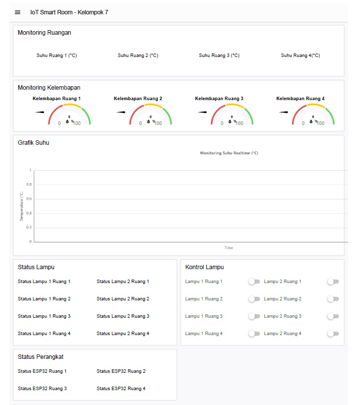
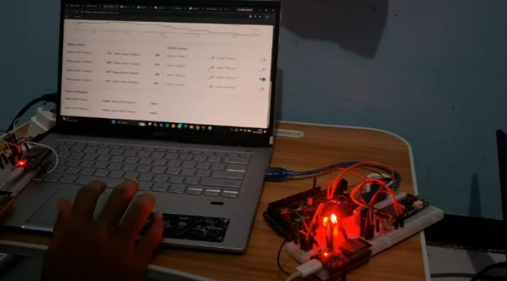

# IoT Smart Room – Kelompok 7
## Sistem Monitoring Suhu, Kelembapan, dan Kontrol Lampu Berbasis ESP32, MQTT, dan Node-RED

### 1. Deskripsi Proyek

IoT Smart Room merupakan sistem monitoring dan kontrol ruangan berbasis Internet of Things (IoT) yang dirancang untuk memantau suhu dan kelembapan serta mengendalikan lampu pada empat ruangan secara terpusat.

Sistem menggunakan empat ESP32 yang terhubung dengan sensor DHT11 dan dua LED pada setiap ruangan. Data sensor dikirim melalui protokol MQTT menggunakan Mosquitto Broker, kemudian diolah dan ditampilkan melalui Node-RED Dashboard 2.0. Pengguna juga dapat mengendalikan delapan lampu melalui dashboard secara real-time.

---

## 2. Informasi Kelompok

**Nama Kelompok:** Kelompok 7  
**Prefix MQTT:** `pens/klp7/`  
**Broker:** Mosquitto MQTT Broker lokal  
**Port MQTT:** 1883  
**Node-RED:** Port 1880  

### Anggota Kelompok

| No. | Nama | NRP | Tanggung Jawab |
|---|---|---|---|
| 1 | Ahmad Munsif Firjatullah | 2124600069 | ESP32 Ruang 1 |
| 2 | Muhammad Aziz Nur Adya | 2124600070 | ESP32 Ruang 2 |
| 3 | M Alifal Husnan Abdillah | 2124600086 | ESP32 Ruang 3 |
| 4 | Hidayat Priyatama | 2124600087 | ESP32 Ruang 4 |

---

## 3. Video Presentasi dan Demo

Dokumentasi video proyek:

-  (https://drive.google.com/drive/folders/1RT2AMfo-Zra9BvP4SHZ3NzzjebpV9rRm)
---

## 4. Arsitektur Sistem

Sistem menggunakan arsitektur komunikasi MQTT dengan satu broker sebagai pusat pertukaran pesan antara empat ESP32 dan Node-RED.

### Diagram Arsitektur

```text
       RUANG 1              RUANG 2
   ┌─────────────┐      ┌─────────────┐
   │    ESP32    │      │    ESP32    │
   │   DHT11     │      │   DHT11     │
   │   LED 1, 2  │      │   LED 1, 2  │
   └──────┬──────┘      └──────┬──────┘
          │                    │
          │      MQTT          │
          └────────┬───────────┘
                   │
          ┌────────▼────────┐
          │                 │
          │  MOSQUITTO MQTT │
          │     BROKER      │
          │   Port 1883     │
          │                 │
          └────────┬────────┘
                   │
          ┌────────▼────────┐
          │                 │
          │    NODE-RED     │
          │   Port 1880     │
          │                 │
          └────────┬────────┘
                   │
          ┌────────▼────────┐
          │  DASHBOARD 2.0  │
          │                 │
          │ - Grafik Suhu   │
          │ - Gauge RH      │
          │ - Status ESP32  │
          │ - Kontrol Lampu │
          └─────────────────┘
```

Ruang 3 dan Ruang 4 juga menggunakan ESP32 fisik dengan mekanisme komunikasi yang sama.

### Alur Komunikasi

1. ESP32 membaca suhu dan kelembapan melalui DHT11.
2. ESP32 mengirim data sensor ke Mosquitto Broker melalui MQTT.
3. Node-RED menerima data menggunakan MQTT In.
4. Data diproses dan ditampilkan pada Dashboard 2.0.
5. Pengguna mengirim perintah ON/OFF melalui Dashboard.
6. Perintah diteruskan melalui MQTT ke ESP32 yang dituju.
7. ESP32 mengendalikan LED dan mengirim status aktual lampu kembali ke Node-RED.

---

## 5. Perangkat Keras

### 5.1 Komponen yang Digunakan

| No. | Komponen | Jumlah | Fungsi |
|---|---|---:|---|
| 1 | ESP32 | 4 | Mikrokontroler setiap ruangan |
| 2 | Sensor DHT11 | 4 | Membaca suhu dan kelembapan |
| 3 | LED | 8 | Aktuator lampu |
| 4 | Resistor 220 Ω | 8 | Pembatas arus LED |
| 5 | Kabel jumper | Secukupnya | Penghubung rangkaian |
| 6 | Breadboard | Secukupnya | Media perakitan |
| 7 | Laptop | 1 | Server MQTT dan Node-RED |

### 5.2 Konfigurasi Pin

Konfigurasi pin mengikuti board dan firmware yang digunakan masing-masing ruangan.

| Ruangan | DHT11 DATA | LED 1 | LED 2 |
|---|---|---|---|
| Ruang 1 |  GPIO 4 | GPIO 25 | GPIO 26 |
| Ruang 2 | GPIO 4 | GPIO 25 | GPIO 26 |
| Ruang 3 | GPIO 4 | GPIO 5 | GPIO 6 |
| Ruang 4 |  GPIO 4 | GPIO 25 | SGPIO 26 |

Koneksi DHT11:
- VCC → 3.3V
- GND → GND
- DATA → GPIO sesuai konfigurasi.

LED dipasang melalui resistor 220 Ω sebagai pembatas arus.

### 5.3 Dokumentasi Rangkaian

Letakkan foto rangkaian aktual pada folder berikut:

```text
docs/images/rangkaian.jpg
```



*Gambar 1. Rangkaian ESP32, sensor DHT11, dan dua LED.*

---

## 6. Rancangan Topic MQTT

Seluruh komunikasi menggunakan prefix kelompok:

```text
pens/klp7/
```

Prefix tersebut digunakan untuk membedakan pesan Kelompok 7 dari kelompok lainnya.

### 6.1 Topic Sensor

| Topic | Arah Komunikasi | Keterangan |
|---|---|---|
| `pens/klp7/ruang1/temperature` | ESP32 → Node-RED | Suhu Ruang 1 |
| `pens/klp7/ruang1/humidity` | ESP32 → Node-RED | Kelembapan Ruang 1 |
| `pens/klp7/ruang2/temperature` | ESP32 → Node-RED | Suhu Ruang 2 |
| `pens/klp7/ruang2/humidity` | ESP32 → Node-RED | Kelembapan Ruang 2 |
| `pens/klp7/ruang3/temperature` | ESP32 → Node-RED | Suhu Ruang 3 |
| `pens/klp7/ruang3/humidity` | ESP32 → Node-RED | Kelembapan Ruang 3 |
| `pens/klp7/ruang4/temperature` | ESP32 → Node-RED | Suhu Ruang 4 |
| `pens/klp7/ruang4/humidity` | ESP32 → Node-RED | Kelembapan Ruang 4 |

### 6.2 Topic Kontrol Lampu

| Topic | Payload | Fungsi |
|---|---|---|
| `pens/klp7/ruang1/led1/set` | ON/OFF | Kontrol LED 1 Ruang 1 |
| `pens/klp7/ruang1/led2/set` | ON/OFF | Kontrol LED 2 Ruang 1 |
| `pens/klp7/ruang2/led1/set` | ON/OFF | Kontrol LED 1 Ruang 2 |
| `pens/klp7/ruang2/led2/set` | ON/OFF | Kontrol LED 2 Ruang 2 |
| `pens/klp7/ruang3/led1/set` | ON/OFF | Kontrol LED 1 Ruang 3 |
| `pens/klp7/ruang3/led2/set` | ON/OFF | Kontrol LED 2 Ruang 3 |
| `pens/klp7/ruang4/led1/set` | ON/OFF | Kontrol LED 1 Ruang 4 |
| `pens/klp7/ruang4/led2/set` | ON/OFF | Kontrol LED 2 Ruang 4 |

Keterangan:
- `ON` = menyalakan LED.
- `OFF` = mematikan LED.

### 6.3 Topic Status

```text
pens/klp7/ruang1/status
pens/klp7/ruang2/status
pens/klp7/ruang3/status
pens/klp7/ruang4/status
```

Status perangkat:
- `online`
- `offline`

Status aktual masing-masing lampu juga menggunakan topic:

```text
pens/klp7/ruangN/led1/status
pens/klp7/ruangN/led2/status
```

### 6.4 Wildcard MQTT

Node-RED menggunakan wildcard untuk menerima data dari seluruh ruangan.

```text
pens/klp7/+/temperature
pens/klp7/+/humidity
pens/klp7/+/status
pens/klp7/#
```

Keterangan:
- `+` menerima satu level topic, yaitu nama ruangan.
- `#` menerima seluruh topic di bawah prefix kelompok.

### 6.5 Konfigurasi Broker

| Parameter | Konfigurasi |
|---|---|
| Broker | Mosquitto lokal |
| Host | IP laptop / 127.0.0.1 untuk client lokal |
| Port | 1883 |
| Username | klp7 |
| Password | Disimpan secara lokal |
| Authentication | Aktif |
| Protocol | MQTT |

ESP32 menggunakan IP laptop sebagai alamat broker, sedangkan Node-RED pada laptop dapat menggunakan `127.0.0.1`.

---

## 7. Cara Menjalankan Sistem

### 7.1 Persiapan Arduino IDE

Instal Arduino IDE dan board ESP32 yang sesuai dengan perangkat.

Library yang digunakan dalam implementasi:
- DHT sensor library by Adafruit.
- Adafruit Unified Sensor.
- PubSubClient untuk komunikasi MQTT.

Pastikan library sesuai dengan perintah `#include` pada file firmware yang digunakan.

### 7.2 Konfigurasi Firmware ESP32

Satu program firmware digunakan dengan penyesuaian konfigurasi setiap ruangan.

Parameter yang harus diperhatikan:

```cpp
#define ROOM 1
```

Sesuaikan nomor ruangan:

| Board | Konfigurasi ROOM |
|---|---|
| ESP32 Ruang 1 | 1 |
| ESP32 Ruang 2 | 2 |
| ESP32 Ruang 3 | 3 |
| ESP32 Ruang 4 | 4 |

Konfigurasi jaringan dan broker:

```cpp
const char* WIFI_SSID = "SSID_WIFI";
const char* WIFI_PASSWORD = "PASSWORD_WIFI";

const char* MQTT_SERVER = "IP_LAPTOP";
const int MQTT_PORT = 1883;
```

Sesuaikan SSID, password Wi-Fi, IP laptop, serta kredensial MQTT sesuai konfigurasi lokal.

**Penting:** Jangan mengunggah password Wi-Fi dan MQTT asli ke repositori GitHub publik. Simpan kredensial pada file lokal yang dimasukkan ke `.gitignore`.

### 7.3 Upload Program ke ESP32

1. Hubungkan ESP32 ke laptop menggunakan kabel USB.
2. Buka Arduino IDE.
3. Pilih board sesuai tipe ESP32.
4. Pilih port COM yang sesuai.
5. Sesuaikan konfigurasi nomor ruangan dan jaringan.
6. Upload program ke board.
7. Buka Serial Monitor dengan baud rate 115200.
8. Pastikan perangkat berhasil terhubung ke Wi-Fi dan MQTT Broker.

Pesan koneksi MQTT yang diharapkan:

```text
MQTT Connection established.
```

Ulangi proses untuk keempat ESP32.

### 7.4 Menjalankan Mosquitto Broker

Jalankan Mosquitto pada laptop menggunakan PowerShell:

```powershell
& "C:\Program Files\mosquitto\mosquitto.exe" -c "C:\Users\ACER\Documents\mosquitto2.conf" -v
```

Pastikan broker aktif dan listener menggunakan port 1883.

### 7.5 Menjalankan Node-RED

Jalankan Node-RED melalui PowerShell:

```powershell
node-red.cmd
```

Buka editor Node-RED:

```text
http://localhost:1880
```

### 7.6 Instalasi Dashboard 2.0

Paket Dashboard yang digunakan:

```text
@flowfuse/node-red-dashboard
```

Instalasi melalui terminal:

```powershell
cd "$env:USERPROFILE\.node-red"
npm.cmd install @flowfuse/node-red-dashboard
```

Setelah instalasi, restart Node-RED jika diperlukan.

### 7.7 Import Flow Node-RED

File flow terdapat pada:

```text
node-red/flows.json
```

Langkah import:

1. Buka editor Node-RED.
2. Klik menu utama di pojok kanan atas.
3. Pilih Import.
4. Pilih file `flows.json`.
5. Klik Import.
6. Periksa konfigurasi MQTT Broker.
7. Pastikan alamat broker, port, username, dan password sudah benar.
8. Klik Deploy.

### 7.8 Mengakses Dashboard

Dashboard dapat dibuka melalui browser laptop:

```text
http://localhost:1880/dashboard/iot-smart-room
```

Untuk mengakses dari HP yang berada pada jaringan Wi-Fi yang sama, gunakan:

```text
http://IP_LAPTOP:1880/dashboard/iot-smart-room
```

Contoh IP laptop yang digunakan saat praktik:

```text
http://10.57.154.212:1880/dashboard/iot-smart-room
```

Akses dari HP memerlukan Node-RED aktif, firewall mengizinkan port 1880, dan jaringan tidak mengaktifkan client isolation.

---

## 8. Flow Node-RED dan Dashboard

### 8.1 Flow Node-RED

Flow Node-RED dibangun untuk menjalankan beberapa fungsi utama:

1. Menerima data suhu dari empat ruangan.
2. Menerima data kelembapan dari empat ruangan.
3. Memproses dan mengirim data ke chart dan gauge.
4. Menerima status online/offline perangkat.
5. Mengirim perintah kontrol lampu.
6. Menerima kembali status aktual lampu.

Screenshot Flow:



*Gambar 2. Flow Node-RED untuk sistem IoT Smart Room.*

### 8.2 Struktur Dashboard

Dashboard 2.0 memiliki enam group:

| No. | Nama Group | Fungsi |
|---|---|---|
| 1 | Monitoring Ruangan | Menampilkan suhu ruangan |
| 2 | Monitoring Kelembapan | Menampilkan kelembapan melalui Gauge |
| 3 | Grafik Suhu | Grafik gabungan empat ruangan |
| 4 | Status Lampu | Menampilkan status delapan LED |
| 5 | Kontrol Lampu | Delapan switch ON/OFF |
| 6 | Status Perangkat | Menampilkan status ESP32 |

Screenshot Dashboard:



*Gambar 3. Dashboard IoT Smart Room Kelompok 7.*

---

## 9. Hasil Pengujian Sistem

Pengujian dilakukan berdasarkan skenario T1 sampai T12 pada modul praktikum.

Keterangan:
- ✓ = Berhasil dan sudah dikonfirmasi.
- ✗ = Gagal.
- ⚠ = Belum terverifikasi atau membutuhkan bukti tambahan.

| Kode | Pengujian | Hasil |
|---|---|---|
| T1 | Koneksi MQTT | ⚠ Perlu dokumentasi Serial Monitor dari keempat ESP32 yang menunjukkan koneksi MQTT berhasil. |
| T2 | Pengiriman data empat ruangan | ⚠ Perlu bukti data suhu dan kelembapan dari keempat ESP32 masuk setiap ±5 detik secara bersamaan. |
| T3 | Grafik suhu | ⚠ Flow grafik gabungan empat ruangan telah dibuat; verifikasi tampilan empat data fisik pada dashboard. |
| T4 | Sensor berubah | ⚠ Perlu pengujian perubahan suhu/kelembapan pada DHT11 Ruang 2 dan memastikan ruangan lain tidak ikut berubah. |
| T5 | Kontrol lampu | ✓ Perintah ON berhasil menyalakan LED 1 Ruang 1 melalui MQTT. Pengujian target Lampu 2 Ruang 3 masih perlu dibuktikan. |
| T6 | Mematikan lampu | ⚠ Perlu bukti pengujian OFF dan kondisi LED mati. |
| T7 | Payload salah | ⚠ Payload ONN digunakan/disiapkan untuk uji validasi; perlu bukti bahwa LED tidak berubah dan ESP32 tetap berjalan normal. |
| T8 | Status online | ⚠ Perlu bukti empat ESP32 menampilkan status online secara bersamaan. |
| T9 | Last Will and Testament | ⚠ Perlu bukti Ruang 4 berubah menjadi offline setelah daya ESP32 dilepas. |
| T10 | Retained message | ⚠ Perlu bukti status terakhir langsung muncul setelah Node-RED dijalankan ulang atau Deploy Full. |
| T11 | Reconnect | ⚠ Perlu bukti ESP32 tersambung kembali setelah Wi-Fi dimatikan dan dinyalakan kembali. |
| T12 | Akses dari HP | ⚠ Alamat akses sudah disiapkan menggunakan IP laptop; perlu konfirmasi dashboard dan saklar berhasil digunakan dari HP. |

### Dokumentasi Pengujian

Screenshot dan foto hasil pengujian disimpan pada folder:

```text
docs/images/pengujian.png
```



*Gambar 4. Dokumentasi pengujian sistem IoT Smart Room.*

---

## 10. Ruangan yang Digunakan

Seluruh empat ruangan dirancang menggunakan ESP32 fisik dengan sensor DHT11 dan dua LED.

| Ruangan | Perangkat | Keterangan |
|---|---|---|
| Ruang 1 | ESP32 + DHT11 + 2 LED | Perangkat fisik |
| Ruang 2 | ESP32 + DHT11 + 2 LED | Perangkat fisik |
| Ruang 3 | ESP32-C5 + DHT11 + 2 LED | Perangkat fisik |
| Ruang 4 | ESP32 + DHT11 + 2 LED | Perangkat fisik |

**Ruangan simulasi:** Tidak ada. Seluruh ruangan menggunakan ESP32 fisik.

---

## 11. Kendala dan Solusi

Selama proses pengerjaan dan pengujian, terdapat beberapa kendala teknis.

| No. | Kendala | Solusi |
|---|---|---|
| 1 | PowerShell tidak mengenali perintah `mosquitto_pub`. | Menggunakan path lengkap `mosquitto_pub.exe` dan operator `&`. |
| 2 | MQTT menampilkan pesan `Connection Refused: not authorised`. | Memeriksa username dan password pada konfigurasi Mosquitto lokal. |
| 3 | Perbedaan alamat IP laptop setelah berpindah jaringan. | Memeriksa IPv4 menggunakan `ipconfig` dan memperbarui alamat broker pada firmware ESP32. |
| 4 | Perbedaan topic MQTT antara contoh modul dan firmware. | Menyamakan topic pada ESP32, MQTT In, MQTT Out, dan terminal pengujian. |
| 5 | PowerShell mengalami kesalahan sintaks saat menjalankan executable. | Menggunakan tanda `&` sebelum alamat lengkap file `.exe`. |
| 6 | Dashboard perlu diakses dari HP. | Menggunakan IP laptop, port 1880, dan memastikan kedua perangkat berada pada jaringan yang sama. |

---

## 12. Pembagian Tugas Anggota

| Anggota | Ruangan | Tanggung Jawab |
|---|---|---|
| Ahmad Munsif Firjatullah | Ruang 1 | Perakitan ESP32, sensor DHT11, kontrol LED, dan pengujian perangkat. |
| Muhammad Aziz Nur Adya | Ruang 2 | Perakitan ESP32, sensor DHT11, kontrol LED, dan pengujian perangkat. |
| M Alifal Husnan Abdillah | Ruang 3 | Integrasi ESP32-C5, sensor DHT11, kontrol LED, dan pengujian perangkat. |
| Hidayat Priyatama | Ruang 4 | Perakitan ESP32, sensor DHT11, kontrol LED, dan pengujian perangkat. |

Pengembangan sistem dilakukan secara kolaboratif, meliputi integrasi MQTT, penyusunan Flow Node-RED, pembuatan Dashboard, pengujian komunikasi, dan dokumentasi proyek.

---

## 13. Kesimpulan

Sistem IoT Smart Room Kelompok 7 dirancang untuk memantau suhu dan kelembapan serta mengendalikan lampu pada empat ruangan menggunakan ESP32, sensor DHT11, MQTT, Mosquitto Broker, dan Node-RED Dashboard 2.0.

Sistem menyediakan satu dashboard terpusat yang menampilkan grafik suhu empat ruangan, empat Gauge kelembapan, status perangkat, serta delapan saklar kontrol lampu.

Berdasarkan percobaan yang telah dikonfirmasi, pengiriman perintah MQTT ON berhasil menyalakan LED 1 pada Ruang 1. Hal ini menunjukkan bahwa komunikasi kontrol dari terminal melalui broker lokal menuju ESP32 telah berfungsi. Pengujian lainnya perlu dilengkapi dengan dokumentasi aktual agar seluruh fungsi dapat dinyatakan berhasil.

---

## 14. Struktur Repositori GitHub

```text
Kel7-TugasNodeRED-ESP32/
│
├── README.md
│
├── esp32/
│   └── esp32_ruang/
│       ├── esp32_ruang.ino
│       ├── secrets.example.h
│       └── .gitignore
│
├── node-red/
│   └── flows.json
│
├── docs/
│   ├── laporan.pdf
│   │
│   └── images/
│       ├── rangkaian.jpg
│       ├── flow.png
│       ├── dashboard.png
│       └── pengujian.png
│
└── video/
    └── LINK.md
```

### Catatan Keamanan

- Jangan mengunggah password Wi-Fi asli ke GitHub.
- Jangan mengunggah password MQTT asli.
- Gunakan file `secrets.example.h` sebagai contoh konfigurasi.
- Simpan file kredensial asli secara lokal dan masukkan ke `.gitignore`.
- Pastikan seluruh dokumentasi dan screenshot tidak menampilkan informasi rahasia.

---

**IoT SMART ROOM – KELOMPOK 7**  
*Monitoring and Controlling Four Rooms Using ESP32, MQTT, and Node-RED.*
